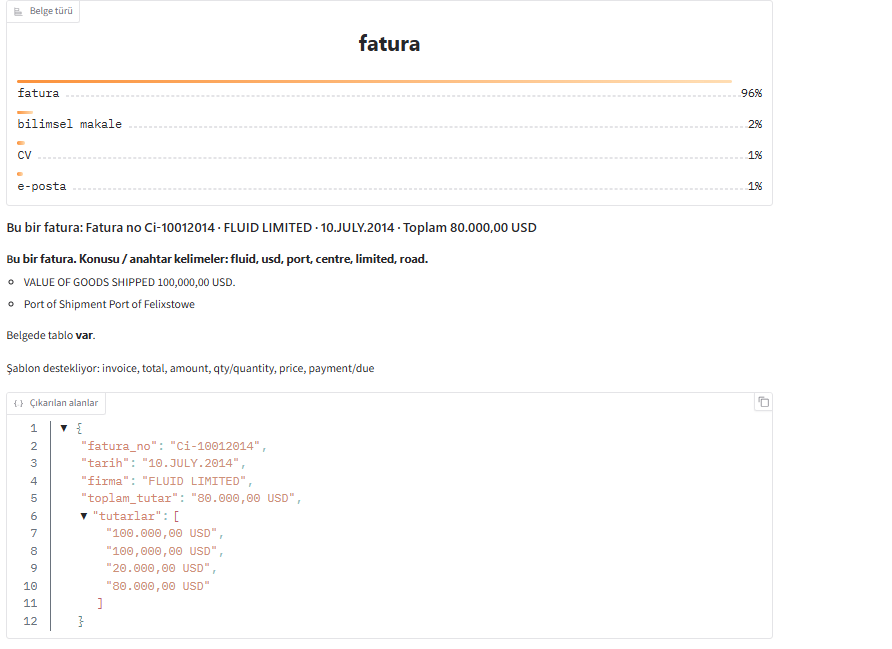
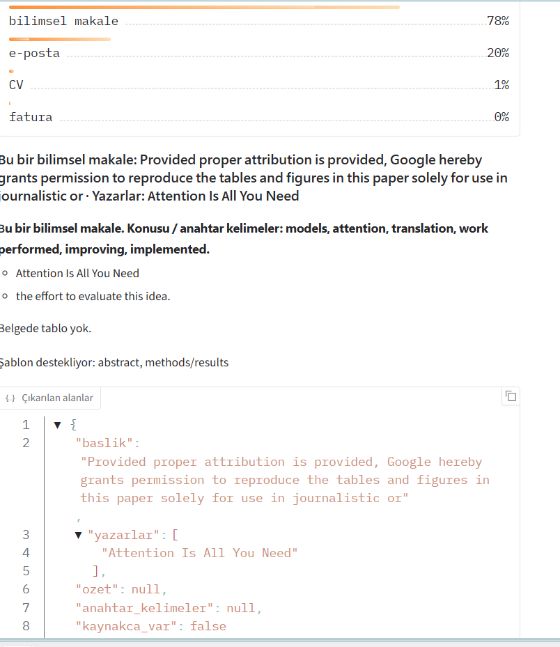
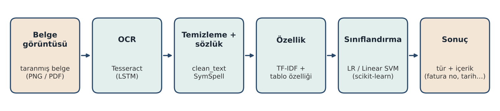
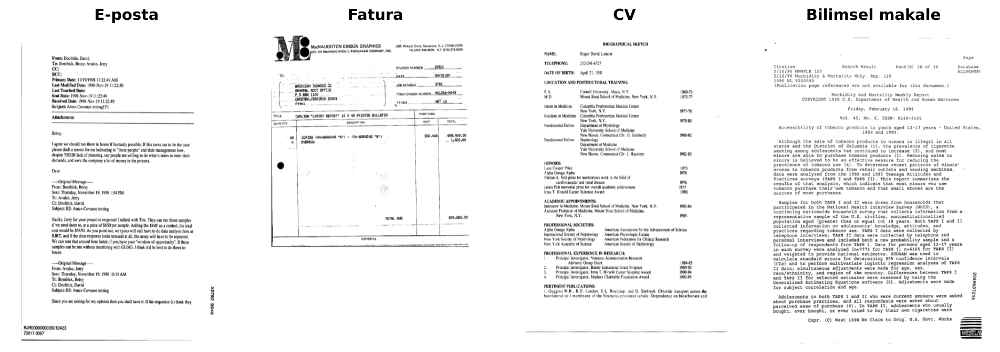
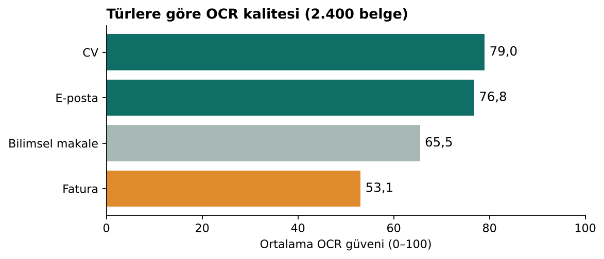
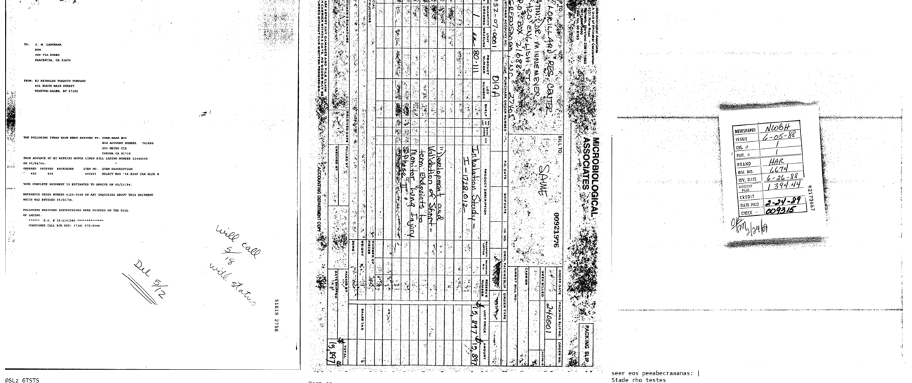
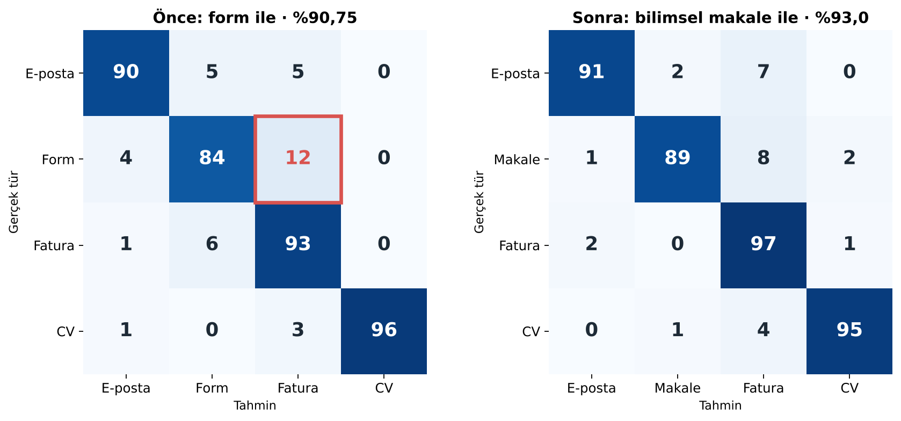
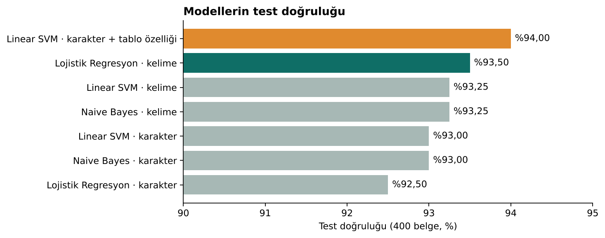
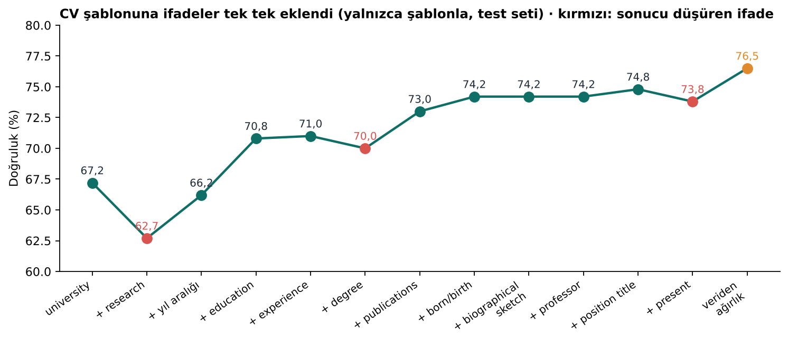
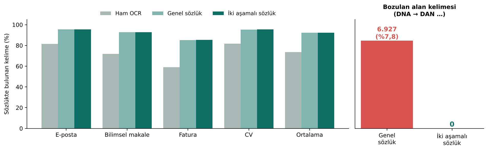

<h1 align="center">OCR Tabanlı Belge Sınıflandırma ve İçerik Çıkarımı</h1>

<p align="center">
  Taranmış belgeyi OCR ile okuyan, türünü bulan ve içinden önemli bilgileri çıkaran sistem<br>
  <i>OCR-based document classification and key information extraction</i>
</p>

<p align="center">
  
  
  
  
  
  
</p>

<p align="center">
  
  
</p>
<p align="center"><sub>Demo arayüzü: veri setinde olmayan, internetten bulunan bir fatura (solda) ve makale (sağda). Sistem türü, olasılıkları, çıkarılan alanları ve kararını destekleyen şablon ifadelerini gösteriyor.</sub></p>

---

## İçindekiler

- [Özet](#özet)
- [Sistem nasıl çalışıyor?](#sistem-nasıl-çalışıyor)
- [Veri seti](#veri-seti)
- [Sonuçlar](#sonuçlar)
  - [OCR kalitesi](#1-ocr-kalitesi)
  - [Sınıf seçimi](#2-sınıf-seçimi-form-yerine-hangi-tür)
  - [Sınıflandırma modelleri](#3-sınıflandırma-modelleri)
  - [Anahtar kelime şablonu](#4-anahtar-kelime-şablonu)
  - [Sözlükle OCR düzeltme](#5-sözlükle-ocr-düzeltme)
  - [İçerik çıkarımı](#6-içerik-çıkarımı)
- [Proje yapısı](#proje-yapısı)
- [Çalıştırma](#çalıştırma)
- [Yol haritası](#yol-haritası)
- [Kaynaklar](#kaynaklar)

---

## Özet

Bankalar, muhasebe ve insan kaynakları her gün çok sayıda kâğıt belgeyi elle ayırıp sisteme giriyor. Bu sürecin ilk adımı belgenin **türünü** bilmek. Bu proje:

1. Taranmış belgeyi **Tesseract OCR** ile metne çeviriyor,
2. Metni temizleyip **sözlükle** OCR hatalarını düzeltiyor,
3. **TF-IDF** ve klasik makine öğrenmesiyle belgenin türünü buluyor: **e-posta, fatura, CV, bilimsel makale**,
4. Türe özel kurallarla içerikten bilgi çıkarıyor (fatura no, tarih, tutar, gönderen, ad, okul…).

GPU gerektirmiyor, açık kaynak araçlarla çalışıyor ve kararını hangi kelimelere dayandırdığını gösteriyor.

| | Sonuç |
|---|---|
| En iyi model (kelime TF-IDF + Lojistik Regresyon) | **%93,5** test doğruluğu |
| Son model (karakter TF-IDF + görüntüden tablo özelliği + Linear SVM) | **%94,0** test doğruluğu |
| Sınıf seçimi (form → bilimsel makale) | %90,75 → %93,0 |
| İki aşamalı sözlük | Bozulan alan kelimesi 6.927 → **0** |

---

## Sistem nasıl çalışıyor?

<p align="center"></p>

| Adım | Araç | Ne yapıyor? |
|---|---|---|
| 1. OCR | [Tesseract](https://github.com/tesseract-ocr/tesseract) (LSTM) | Görüntüdeki yazıyı metne çeviriyor; her kelime için 0–100 arası güven puanı ve sayfadaki konumunu veriyor |
| 2. Temizleme | `src/text_clean.py` | Anlamsız sembol satırlarını, tirelemeyi temizliyor; e-posta adresi, para tutarı ve sayıları ortak simgelere (`emailaddr`, `moneyamt`) çeviriyor |
| 3. Sözlükle düzeltme | [SymSpell](https://github.com/wolfgarbe/SymSpell) + alan sözlüğü (`src/ocr_fix.py`) | OCR'ın yanlış okuduğu kelimeleri düzeltiyor (`wih → with`, `Dater → Date`) |
| 4. Özellik | TF-IDF (kelime ve karakter) + tablo özelliği | Metni sayılara çeviriyor; görüntüdeki tablo çizgilerini OpenCV ile sayıyor |
| 5. Sınıflandırma | Naive Bayes · Lojistik Regresyon · Linear SVM | Belgenin türünü ve her türün olasılığını veriyor; olasılık düşükse "emin değilim" diyor |
| 6. İçerik çıkarımı | Türe özel kurallar (`src/extract.py`) | Etiket, tarih/tutar biçimi ve satır konumuyla alanları buluyor |

---

## Veri seti

[RVL-CDIP](https://www.cs.cmu.edu/~aharley/rvl-cdip/) (Harley ve ark., ICDAR 2015): 1990'lardan kalma **400.000 gerçek taranmış şirket belgesi**, 16 tür, yaklaşık 38 GB. Tam veri seti Colab'a sığmadığı için orijinal eğitim/doğrulama/test ayrımını koruyan dengeli alt küme ([`jinhybr/rvl_cdip_400_train_val_test`](https://huggingface.co/datasets/jinhybr/rvl_cdip_400_train_val_test)) kullanıldı. Sentetik veri yok.

<p align="center"></p>

| Tür | RVL-CDIP adı | Eğitim | Doğrulama | Test |
|---|---|---|---|---|
| E-posta | `email` | 400 | 100 | 100 |
| Fatura | `invoice` | 400 | 100 | 100 |
| CV | `resume` | 400 | 100 | 100 |
| Bilimsel makale | `scientific_publication` | 400 | 100 | 100 |
| **Toplam** | | **1.600** | **400** | **400** |

Ayarlar ve sınıf seçimi **doğrulama** setine göre yapıldı; **test** seti yalnızca en sonda, sonucu ölçmek için kullanıldı. Görüntüler lisans ve boyut nedeniyle repoya eklenmedi; `01_data_preparation.ipynb` otomatik indiriyor.

---

## Sonuçlar

### 1. OCR kalitesi

<p align="center"></p>

| Tür | Ort. kelime | Ort. OCR güveni | Sözlükte bulunan (NLTK) |
|---|---|---|---|
| CV | 314 | 79,0 | %73 |
| E-posta | 116 | 76,8 | %76 |
| Bilimsel makale | 533 | 65,5 | %63 |
| Fatura | 101 | 53,1 | %53 |

Düz metin ağırlıklı CV ve e-postalar iyi okunuyor. Faturalardaki **tablo, logo, damga, el yazısı ve dönük sayfalar** OCR'ı belirgin şekilde zorluyor. OCR kalitesi sınıflandırmayı da etkiliyor: son model iyi okunan belgelerde **%94,9**, zayıf okunanlarda **%90,0** doğru.

<p align="center"></p>
<p align="center"><sub>En kötü okunan üç fatura: dönük sayfa, el yazısı ve yoğun tablo (OCR güveni 0–15).</sub></p>

> Ön işleme (median filtre, eğiklik düzeltme, Otsu ikilileştirme) pilot deneyde RVL-CDIP'in düşük çözünürlüklü taramalarında ince harf çizgilerini bozup OCR güvenini 65,9'dan 38,3'e düşürdüğü için OCR ham görüntü üzerinde çalıştırıldı (`03`).

### 2. Sınıf seçimi: form yerine hangi tür?

İlk sürümde **form** türü vardı ve 100 formun **12'si fatura** sanılıyordu: ikisi de tablo ve kutulardan oluşuyor, metin olarak birbirine çok benziyor. Formun yerine 3 aday tür denendi (dilekçe, gazete haberi, bilimsel makale) ve aynı modelle 7 senaryo karşılaştırıldı.

<p align="center"></p>

| Senaryo | Test doğruluğu |
|---|---|
| Mevcut (e-posta, form, fatura, CV) | %90,75 |
| Form → dilekçe | %91,5 |
| Form → gazete haberi | %91,0 |
| **Form → bilimsel makale** | **%93,0** |
| 5 sınıf (+ dilekçe / + gazete / + makale) | %88,6 / %88,6 / %89,2 |

Bilimsel makale uzun ve akademik metni sayesinde en iyi ayrışan tür oldu. 5 sınıflı senaryolarda form içeride kaldığı için karışma sürdü.

### 3. Sınıflandırma modelleri

Metin iki farklı TF-IDF ile sayılara çevrildi (**kelime**: tek kelimeler ve ikililer; **karakter**: 3–5 harflik parçalar, OCR'ın bozduğu kelimelerin doğru kısmını yakalamak için). Üç algoritma ile 6 model eğitildi; her modelin ayarı doğrulama setinde seçildi.

<p align="center"></p>

- 6 model %92,5–%93,5 aralığında. Farklar **McNemar testine göre anlamlı değil** (tüm p > 0,28); en iyi modelin %95 güven aralığı %91,0–%95,8.
- **Tablo özelliği:** OCR'ın bozduğu tablo bilgisi görüntüden alındı (OpenCV ile yatay/dikey çizgi sayısı, kesişim sayısı, çizgi oranı, tablo var/yok). Doğruluk %94,0'a çıktı; en çok faturaya yaradı (fatura F1 0,907 → 0,933).
- Hataların çoğu **fatura sütununda**: kötü okunan e-posta, makale ve CV'ler fatura sanılıyor.

### 4. Anahtar kelime şablonu

Her tür için o türün belgelerinde sık geçen ifadeler belirlendi:

| Tür | Şablon ifadeleri |
|---|---|
| E-posta | `from:`, `to:`, `subject:`, `cc:`, e-posta adresi |
| Fatura | `invoice`, `total`, `amount`, `quantity`, `price`, para işaretli tutar (`$1,394.44`, `€250`) |
| CV | `education`, `experience`, `university`, `degree`, `biographical sketch`, yıl aralığı (`1985–present`) |
| Bilimsel makale | `abstract`, `introduction`, `methods`, `references`, `et al.` |

CV şablonuna ifadeler **tek tek** eklendi ve her adımda test seti yalnızca şablonla sınıflandırıldı:

<p align="center"></p>

`research` eklenince doğruluk %67,2'den **%62,7'ye düştü**, çünkü bu kelime makalelerde de sık geçiyor. Kötü ifadeleri atmak yerine her ifadeye eğitim verisinden ağırlık verildi:

```
ağırlık = ifadenin kendi türünde geçme oranı − diğer türlerdeki en yüksek geçme oranı
```

Böylece başka türlerde de geçen ifadeler daha az sayıldı ve doğruluk **%76,5**'e çıktı (makale → CV hatası 37 → 10). Şablon, modele eklendiğinde sistemin kararını *"şablon destekliyor: from, to, subject"* şeklinde açıklamasını sağlıyor.

### 5. Sözlükle OCR düzeltme

Üç katmanlı düzeltici: OCR karışıklık kuralları (`rn ↔ m`, `1 ↔ l`), alan adı kuralı (`Dater → Date`) ve **SymSpell** İngilizce sıklık sözlüğü (82.834 kelime; SCOWL + Google Books Ngram).

<p align="center"></p>

| Aşama | Sözlükte bulunan kelime | Düzeltilen | Bozulan alan kelimesi | Test doğruluğu |
|---|---|---|---|---|
| Ham OCR | %73,5 | – | – | %93,25 |
| 1 · Genel sözlük | %92,2 | 88.654 | **6.927 (%7,8)** | %93,00 |
| 2 · İki aşamalı sözlük | %92,2 | 82.112 | **0** | %93,00 |

- **Başarısız deneme:** Genel sözlük bilimsel terimleri tanımadığı için düzeltmelerin %7,8'inde doğru kelimeyi bozdu: `DNA → DAN` (499 kez), `NIH → NIL`, `PhD → Pad`, `vitro → nitro`.
- **Çözüm, iki aşamalı sözlük:** Eğitim belgelerinden genel sözlükte olmayan, en az 5 belgede geçen ve %60'ı tek türde toplanan **380 kelimelik alan sözlüğü** çıkarıldı. Sık bir kelimeye 1 harf uzak olanlar (`wih`) ve birleşik yazımlar (`ofthe`) OCR hatası sayılıp dışarıda bırakıldı. Önce alan sözlüğü korunuyor, sonra genel sözlük çalışıyor.
- **Sınıflandırma değişmedi:** Model OCR'ın tutarlı hatalarını (`ofthe` gibi) zaten ayırt edici ipucu olarak öğrenmişti. Sözlüğün asıl faydası, kelimenin doğru yazılmasının önemli olduğu **içerik çıkarımında**.

| Tür | OCR'ın okuduğu | Genel sözlük | İki aşamalı |
|---|---|---|---|
| E-posta | `impiementation plans` | implementation plans ✓ | implementation plans ✓ |
| E-posta | `Youth Orgs: Daragan` | Youth Org: Dragon ✗ | Youth Org: Daragan ✓ |
| CV | `educavon, postdoctoral traning` | education, postdoctoral training ✓ | education, postdoctoral training ✓ |
| Makale | `APPLIED TONICOLOGY` | APPLIED TOXICOLOGY ✓ | APPLIED TOXICOLOGY ✓ |

> OCR kalitesi bölümündeki "sözlükte bulunan" oranı NLTK kelime listesiyle, buradaki oran SymSpell sözlüğüyle hesaplandı. NLTK listesinde çoğul ve çekimli biçimler eksik olduğu için oranlar orada daha düşük; türlerin sıralaması iki ölçümde de aynı.

### 6. İçerik çıkarımı

| Tür | Çıkarılan alanlar |
|---|---|
| E-posta | gönderen, alıcı, konu, tarih, e-posta adresleri, gövde özeti |
| Fatura | fatura no, tarih, firma, toplam tutar, tutarlar |
| CV | ad soyad, üniversite, bölüm/derece, e-posta, telefon |
| Bilimsel makale | başlık, yazarlar, özet |

Çıkarım, 110 alan **resme bakılarak elle** işaretlenip değerlendirildi (Doğru / Yanlış / Kaçırıldı / Belgede yok). Kurallar, daha önce hiç bakılmamış 20 yeni belgede ölçüldü: **precision 0,525 → 0,61**, recall 0,70 ([ayrıntılar](results/elle_degerlendirme_yeni20/README.md)). E-postada iyi (precision 0,83), faturada zayıf: firma adı çoğunlukla logo içinde ve OCR okuyamıyor.

---

## Proje yapısı

```
document-classification-ocr/
├── notebooks/          01–13 numaralı Colab notebook'ları (aşağıda)
├── src/
│   ├── ocr_core.py     Tesseract OCR, görüntü ön işleme, dönük sayfa düzeltme, tablo tespiti
│   ├── ocr_batch.py    Toplu OCR (kaldığı yerden devam eder)
│   ├── text_clean.py   Metin temizleme ve model için normalizasyon
│   ├── ocr_fix.py      Sözlükle OCR düzeltme: genel sözlük + iki aşamalı (alan) sözlük
│   ├── sablon.py       Anahtar kelime şablonları ve veriden ağırlık
│   ├── final_model.py  Son model: karakter TF-IDF + tablo özelliği + kalibre Linear SVM
│   └── extract.py      Türe özel içerik çıkarımı ve konu özeti
├── results/            Elle değerlendirme ve vize özet tabloları (CSV)
├── tools/              Colab'da notebook çalıştırma yardımcısı
├── docs/images/        README görselleri
└── PROJE_REHBERI.md    Dosyaların nerede olduğu (Türkçe rehber)
```

| Notebook | Ne yapıyor? |
|---|---|
| [`01_data_preparation`](notebooks/01_data_preparation.ipynb) | Veri setini indirir, türleri filtreler, görüntüleri kaydeder |
| [`02_ocr_pipeline`](notebooks/02_ocr_pipeline.ipynb) | Tesseract OCR: metin, kelime kutuları, güven puanları |
| [`03_ocr_analysis_cleaning`](notebooks/03_ocr_analysis_cleaning.ipynb) | Ön işleme pilot deneyi, OCR kalite analizi, metin temizleme |
| [`04_classification`](notebooks/04_classification.ipynb) | TF-IDF + NB / LR / SVM, metrikler, karışıklık matrisi, McNemar |
| [`05_end_to_end_demo`](notebooks/05_end_to_end_demo.ipynb) | Yeni belge → OCR → tür → içerik; Gradio demo arayüzü |
| [`06_sinif_secimi`](notebooks/06_sinif_secimi.ipynb) | Form yerine aday türler, 7 senaryo |
| [`07_sablon_ve_sozluk`](notebooks/07_sablon_ve_sozluk.ipynb) | Anahtar kelime şablonu ve sözlükle OCR düzeltme |
| [`08_gurultu_giderme`](notebooks/08_gurultu_giderme.ipynb) | Median, Gauss, non-local means, Fourier: hangisi metni en az bozuyor? |
| [`09_elle_degerlendirme`](notebooks/09_elle_degerlendirme.ipynb) | İçerik çıkarımını resme bakarak elle değerlendirme |
| [`10_son_model`](notebooks/10_son_model.ipynb) | Son model (metin + tablo), "emin değilim" çıktısı, dönük sayfa düzeltme |
| [`11_ocr_x2`](notebooks/11_ocr_x2.ipynb) | Görüntüyü 2 kat büyütüp yeniden OCR; karar doğrulama setinde |
| [`12_yeni_belgelerde_cikarim`](notebooks/12_yeni_belgelerde_cikarim.ipynb) | Çıkarım kurallarının görülmemiş 20 belgede değerlendirilmesi |
| [`13_vize_ekleri`](notebooks/13_vize_ekleri.ipynb) | Test setinin tamamı, şablon adım adım, sözlük aşamaları |

---

## Çalıştırma

Proje **Google Colab**'da çalışır; veriler ve çıktılar Google Drive'da `MyDrive/bitirme_ocr/` altına kaydedilir.

1. [colab.research.google.com](https://colab.research.google.com) → **File → Open notebook → GitHub** → `senaozkann/document-classification-ocr`
2. Notebook'u seçip **Runtime → Run all**
3. Önerilen sıra: `01 → 02 → 06 → 03 → 04 → 10 → 05` (diğerleri deney notebook'ları)

OCR adımı CPU'da çalışır (2.400 belge ≈ 30–60 dk); GPU gerekmez. Oturum kapanırsa OCR kaldığı yerden devam eder.

---

## Yol haritası

- [x] Veri seti, OCR ve OCR kalite analizi
- [x] Sınıf seçimi ve sınıflandırma modelleri
- [x] Anahtar kelime şablonu ve sözlükle OCR düzeltme
- [x] İçerik çıkarımı ve elle değerlendirme (ilk sürüm)
- [ ] İçerik çıkarımının iyileştirilmesi (fatura firması, CV tablo sütunları, makale özeti)
- [ ] Tüm test setinde OCR hatası ile model hatasının ayrı raporlanması
- [ ] Görüntü iyileştirme (gürültü giderme, dönük sayfa)
- [ ] Demo arayüzünün son hali

---

## Kaynaklar

1. Smith, R. (2007). *An Overview of the Tesseract OCR Engine.* ICDAR.
2. Harley, A. W., Ufkes, A., Derpanis, K. G. (2015). *Evaluation of Deep Convolutional Nets for Document Image Classification and Retrieval.* ICDAR.
3. Vinciarelli, A. (2005). *Noisy Text Categorization.* IEEE TPAMI, 27(12).
4. Xu, Y. ve ark. (2020). *LayoutLM: Pre-training of Text and Layout for Document Image Understanding.* KDD.
5. Larson, S., Lim, G., Leach, K. (2023). *On Evaluation of Document Classification with RVL-CDIP.* EACL.
6. Salton, G., Buckley, C. (1988). *Term-weighting Approaches in Automatic Text Retrieval.* Information Processing & Management.
7. Pedregosa, F. ve ark. (2011). *Scikit-learn: Machine Learning in Python.* JMLR.
8. Garbe, W. *SymSpell.* [github.com/wolfgarbe/SymSpell](https://github.com/wolfgarbe/SymSpell)

---

<p align="center">
  <b>Sena Sultan Özkan</b> · Konya Teknik Üniversitesi, Bilgisayar Mühendisliği · Bitirme Projesi 2026<br>
  Danışman: Doç. Dr. Nurdan Baykan
</p>
